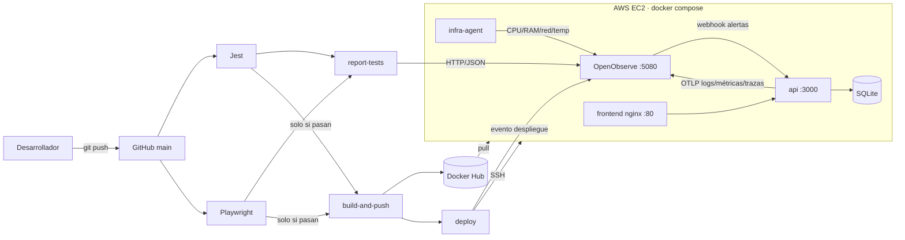

# Proyecto Parcial 2 – Biblioteca con CI/CD, Playwright y Observabilidad (OpenObserve)

Aplicación de biblioteca con **login, CRUD de usuarios y CRUD de productos (libros, autores, categorías)**.
Cada `push` a `main` ejecuta las pruebas (Jest + Playwright). **Solo si todas pasan** se publican las
imágenes en Docker Hub y se actualizan los contenedores en **AWS EC2**. Todo el ciclo se registra en
**OpenObserve**, que también recibe logs, métricas y trazas (OpenTelemetry) de la API y las métricas
de infraestructura de la instancia.

| Pieza | Tecnología | Imagen |
|---|---|---|
| Backend | Node.js 22, Express 5, SQLite, OpenTelemetry | `node:22-slim` |
| Frontend | HTML/CSS/JS + nginx (proxy `/api`) | `nginx:1.27-alpine` |
| Pruebas | Jest + Supertest (83) · Playwright E2E (16) | — |
| Observabilidad | OpenObserve + agente de infraestructura | `openobserve`, `node:22-alpine` |
| CI/CD | GitHub Actions → Docker Hub → EC2 (SSH) | — |

## 1. Arquitectura



### Pipeline (`.github/workflows/main.yml`)

1. **test-backend** – `npm run test:ci` (Jest, cobertura mínima 70%).
2. **test-e2e** – `docker compose up --build --wait` + `npx playwright test` contra los mismos contenedores.
3. **report-tests** (siempre) – envía a OpenObserve `status`, commit, rama, usuario y resultado de Jest/Playwright.
   Si algo falló marca *Despliegue bloqueado* y los jobs siguientes **no se ejecutan (no hay SSH a EC2)**.
4. **build-and-push** – publica `webapp` y `webapp-frontend` con etiquetas `:latest` y `:<sha>`.
5. **deploy** – copia `deploy/` a la EC2, ejecuta `deploy.sh` (compose pull/up + verificación de
   `GET /api/health`), registra el evento de despliegue y crea/actualiza dashboards y alertas.

### Observabilidad

| Señal | Origen | Stream en OpenObserve |
|---|---|---|
| Logs estructurados (peticiones, login, excepciones) | API · OTLP | `biblioteca_api` (logs) |
| Métricas `http_server_requests_total`, `http_server_errors_total`, `http_server_request_duration_ms` (method, route, status_code) | API · OTLP | metrics |
| Trazas HTTP → Express → consultas SQLite | API · OTLP | `default` (traces) |
| CPU, RAM, ancho de banda, disco, temperatura | `deploy/infra-agent` · HTTP/JSON | `infra_metrics` (logs) |
| Ejecuciones de pruebas y despliegues | GitHub Actions · HTTP/JSON | `cicd_pipeline` (logs) |
| Alertas disparadas | webhook → API | `biblioteca_api` (`event = alerta_recibida`) |

Dashboards: **1. Infraestructura EC2**, **2. Aplicación API (OpenTelemetry)**, **3. Pipeline CI/CD y Alertas**.
Alertas: CPU > 80%, RAM > 90%, temperatura > 75 °C, errores 5xx, latencia p95 > 1 s, tasa de error > 50%, pipeline fallido.

> Las instancias EC2 virtualizadas normalmente no exponen sensores térmicos; en ese caso el agente reporta
> una temperatura **estimada** a partir de la carga de CPU y la marca con `temperatura_fuente = estimada`.

## 2. Uso local

```bash
npm install
npm test                         # Jest (backend)
docker compose up -d --build     # frontend + API en http://localhost:8080
npx playwright install chromium  # solo la primera vez
npm run test:e2e                 # Playwright (frontend + backend)
```

Usuario inicial: `admin@biblioteca.com` / `Admin123!` (cambiable con `ADMIN_EMAIL` / `ADMIN_PASSWORD`).

## 3. Configuración en GitHub y AWS

**GitHub → Settings → Secrets and variables → Actions**

| Secret | Contenido |
|---|---|
| `DOCKERHUB_USERNAME` / `DOCKERHUB_TOKEN` | Usuario y Personal Access Token (Read & Write) |
| `EC2_HOST` / `EC2_USER` / `EC2_SSH_KEY` | IP pública, `ubuntu` y contenido del `.pem` |
| `OPENOBSERVE_USER` | Correo del usuario raíz de OpenObserve (ej. `admin@biblioteca.com`) |
| `OPENOBSERVE_PASSWORD` | Contraseña de OpenObserve (sin `$`, comillas ni espacios) |
| `ADMIN_PASSWORD` *(opcional)* | Contraseña inicial del administrador de la app |
| `OPENOBSERVE_URL` *(opcional)* | Solo si OpenObserve no está en `http://EC2_HOST:5080` |

**Security Group de la EC2 – reglas de entrada:** 22 (SSH), 80 (HTTP) y **5080 (OpenObserve)**.
Se recomienda una instancia con ≥ 2 GB de RAM; en instancias de 1 GB `deploy.sh` crea 2 GB de swap.

## 4. Demostración de los criterios de aceptación

1. **Commit con error** – p. ej. cambiar en `frontend/index.html` el texto `Iniciar sesión` del botón,
   o hacer que `GET /api/health` responda 500. Playwright falla → `report-tests` registra
   `status = failure` en OpenObserve → `build-and-push` y `deploy` se omiten (no hay SSH a EC2).
2. **Commit válido** – todas las pruebas pasan → imágenes nuevas → contenedores actualizados en EC2 →
   evento `despliegue/success` en OpenObserve.
3. **OpenObserve** (`http://<EC2_HOST>:5080`) – logs del pipeline, trazas de cada petición y las gráficas
   de CPU, ancho de banda, temperatura y RAM.

## 5. Endpoints

| # | Método | Ruta | Auth |
|---|---|---|---|
| 1-2 | GET, POST | /api/categorias | — |
| 3-4 | GET, POST | /api/autores | — |
| 5-9 | GET, GET/:id, POST, PUT/:id, DELETE/:id | /api/libros | — |
| 10 | POST | /api/database/backup | — |
| 11 | DELETE | /api/database/vaciar | — |
| 12 | GET | **/api/health** | — |
| 13 | POST | /api/auth/login | — |
| 14 | GET | /api/auth/me | Bearer |
| 15-19 | GET, GET/:id, POST, PUT/:id, DELETE/:id | /api/usuarios | Bearer |
| 20 | POST | /api/alertas/webhook | `x-alert-token` |

Todas las respuestas usan `{ "statusCode": 200, "data": [] }`.
